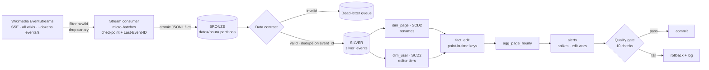
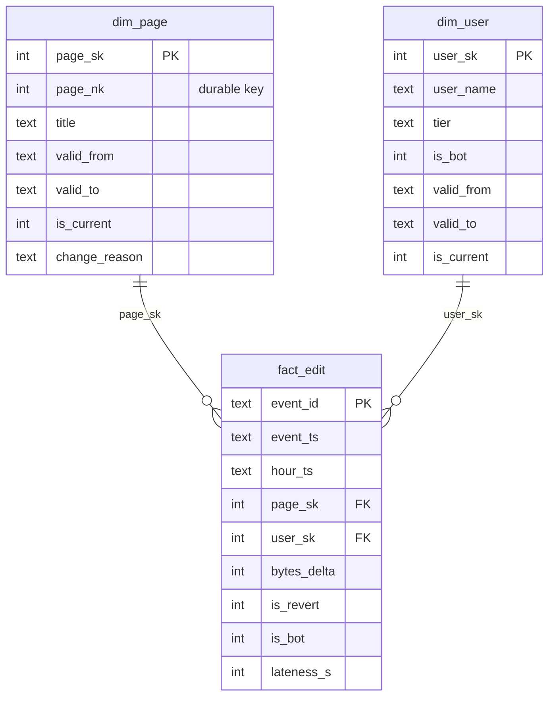

# azwiki-pulse · Real-time pipeline for Azerbaijani Wikipedia

**What is Azerbaijan editing right now?** `azwiki-pulse` consumes the live Wikimedia event stream, keeps every edit made on Azerbaijani Wikipedia (az.wikipedia.org), and turns it into an analytics model that tracks trending topics, editing spikes, edit wars, page renames and how editors evolve over time.

It is a streaming data engineering project built around the problems real event streams have: duplicate deliveries, late-arriving events, malformed records, dropped connections, and entities that change identity (renamed pages).

## Architecture



Two implementations of the same design:

| | Local (`pulse/`) | Microsoft Fabric (`fabric/`) |
|---|---|---|
| Engine | Python + SQL (SQLite) | PySpark + Delta Lake |
| Ingestion | live SSE consumer | reads the bronze files uploaded to `Files/bronze` |
| De-duplication | `INSERT OR IGNORE` on `event_id` | Delta `MERGE` on `event_id` |
| SCD Type 2 | incremental, row by row | window functions (`lag`/`lead`) + Delta `MERGE` |
| Spike detection | z-score vs 24 h baseline | zero-filled hour × page grid + sliding window |
| Dependencies | `requests` only | Fabric Spark runtime |

## Hard problems this project solves

| Problem | Solution |
|---|---|
| **Connection drops / restarts** | Checkpoint of the last SSE id, resumed with the `Last-Event-ID` header; exponential backoff on reconnect. |
| **Duplicates** (at-least-once delivery) | Checkpoint is saved *after* the bronze file → replay is possible → silver de-duplicates on `event_id` → effectively exactly-once. |
| **Half-written files** | Bronze files are written as `.tmp` and atomically renamed. |
| **Malformed records** | A data contract validates every event; failures go to a dead-letter table with a reason instead of being silently dropped. |
| **Late-arriving events** | Event time and ingestion time are stored separately (`lateness_s`); facts are joined to the dimension version valid *at event time*, and only the affected hourly buckets and alerts are recomputed. |
| **Entities that change identity** | A page rename closes the old `dim_page` version and opens a new one with the same durable key (`page_nk`), so a page's history survives renames. A late edit using the *old* title still lands on the correct version. |
| **Slowly changing attributes** | `dim_user` keeps a version per editor tier (newcomer → active → power) and bot flag. |
| **Partial failures** | Silver, gold, alerts, file manifest and watermark are written in one transaction; a failed quality check rolls everything back. |
| **Incremental correctness** | A test proves that processing the stream in chunks gives exactly the same result as processing it in one batch. |

## Data model (gold)



Plus `agg_page_hourly`, `alerts`, `silver_dead_letter`, `etl_runs`, `etl_file_manifest`.

## Quick start

```bash
pip install -r requirements.txt

python pulse_cli.py demo                  # offline: 36 h of synthetic events → full pipeline → report
python pulse_cli.py stream --minutes 15   # live: consume Azerbaijani Wikipedia edits
python pulse_cli.py process               # bronze → silver → gold (incremental)
python pulse_cli.py report                # trending pages, alerts, SCD2 history, data health

python -m unittest -v                     # 14 tests
```

Before streaming, put your contact e-mail in `USER_AGENT` in `pulse/config.py` (Wikimedia's User-Agent policy).

Sample `report` output (demo data):

```
=== ALERTS ===
type      hour (UTC)           page                   score  details
spike     2026-10-21 06:00:00  Neftçi (futbol klubu)  28.62  30 edits vs baseline 1.38±0.90/h
edit_war  2026-10-21 02:00:00  Xəzər dənizi           6.0    9 human edits by 4 editors, 6 reverts

=== PAGE RENAMES (dim_page SCD2) ===
page_nk  title         valid_from           valid_to             reason
7        Gəncə şəhəri  2026-10-20 00:10:06  2026-10-20 12:00:05  first_seen
7        Gəncə         2026-10-20 12:00:05  9999-12-31 23:59:59  renamed_from:Gəncə şəhəri
```

## Running on Microsoft Fabric

1. Create a Lakehouse and upload the `data/bronze` folder to `Files/bronze`.
2. Import `fabric/01_bronze_to_silver.ipynb` and `fabric/02_silver_to_gold.ipynb`, attach the Lakehouse, run them in order.
3. Build a Power BI report on the Delta tables (Direct Lake).

## Orchestration & CI

- `dags/azwiki_pulse_dag.py` – Airflow DAG: `stream (14 min) >> process`, every 15 minutes, `max_active_runs=1` so two consumers never share a checkpoint.
- `.github/workflows/tests.yml` – GitHub Actions runs the tests and the end-to-end demo on every push.

## Project structure

```
pulse/
  sse.py        hand-written Server-Sent Events parser
  ingest.py     live consumer: filter, micro-batch, checkpoint, reconnect
  bronze.py     atomic bronze writer + checkpoint
  contract.py   data contract → typed silver row or rejection reason
  silver.py     file-level incremental load, dead-letter, de-duplication
  gold.py       SCD2 dim_page / dim_user, fact_edit, hourly aggregates, alerts
  quality.py    SCD2 integrity, referential integrity, cross-layer reconciliation
  process.py    transaction + run logging
  sample.py     synthetic stream with planted scenarios and dirty data
  report.py     console report
sql/schema.sql  all tables, partial unique indexes, reporting view
fabric/         PySpark + Delta notebooks for Microsoft Fabric
dags/           Airflow DAG
tests/          14 unit + end-to-end tests
```

Data: [Wikimedia EventStreams](https://www.mediawiki.org/wiki/EventStreams) (public, CC BY-SA content).
